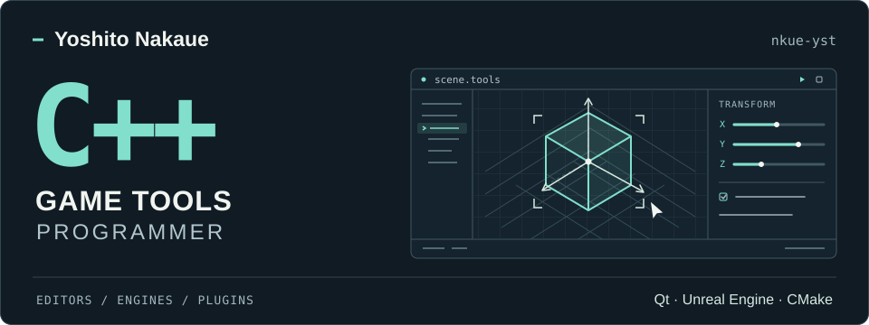

  

<table width="100%">
  <tr>
    <td width="33%" align="center">
      <a href="https://github.com/nkue-yst/gEngine"><strong>gEngine ↗</strong></a> 
      Engine · Editor
    </td>
    <td width="33%" align="center">
      <a href="https://github.com/nkue-yst/BinPackLib"><strong>BinPackLib ↗</strong></a> 
      Asset packing · CLI
    </td>
    <td width="33%" align="center">
      <a href="https://github.com/nkue-yst/AudioPluginHostPlugin"><strong>Audio Plugin Host ↗</strong></a> 
      Unreal Engine · VST3
    </td>
  </tr>
</table>

  <a href="https://twitter.com/8190_Yossyi">X ↗</a>
  &nbsp; / &nbsp;
  <a href="https://yossyi.itch.io">itch.io ↗</a>

